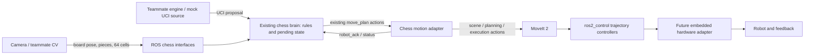

# Configurable chess motion and teammate interfaces

This extends the supplied dual SCARA/MoveIt implementation. Existing packages and launch names remain. All dimensions, piece cylinders, capture trays, motion margins and robot mounting positions in the default configuration are **simulation placeholders, not final mechanical measurements**.

## What existed and what changed

| Requirement | Existing support | Incremental extension |
|---|---|---|
| CAD mechanics / IK | Supplied SCARA twice, exact source transforms/limits, numeric IK and position-only KDL | Shared exact-chain model reused; no replacement robot or new mechanical axes |
| Board / square mapping | Fixed 240/210 mm board and square TFs | Shared YAML, rectangular dimensions/pitches, full XYZ/RPY placement, live parameter updates, calibrated board pose input |
| Joint sliders | `display.launch.py`, GUI or non-GUI joint-state publisher | Separate `manual.launch.py`, shared configuration, support geometry and matching chess frame aliases; paths with spaces supported |
| MoveIt | OMPL, individual/combined groups, RViz, two mock trajectory controllers | Retained; dynamic scene owner supplies board/support/pieces; position-only IK and real controller-action execution tested |
| Chess logic | Stockfish, legal moves, captures/castling/en passant/promotion, pending plans, robot ack plus fresh-vision commit | UCI topic adapter and mock engine mode; existing rule/confirmation logic retained |
| Physical move planning | Old offline planar executor, disconnected from CAD | New adapter consumes the **existing action schema** and performs collision-aware approach/pick/lift/transfer/place/retreat/park |
| Embedded / vision | Existing symbolic vision and ack contract | Generic gripper request/result handshake, ROS control boundary, mock sources, board pose and piece-position observations; no camera algorithms or device-specific driver |

The old `chess_robot_executor` remains an offline prototype with its original geometry. Its live mode stays disabled; it does not drive the CAD robot. The new package is `chess_motion_interface`.

## Build once; use separate test modes

From the repository root:

```bash
cd Chess_Robot_M6_Merged_v5/simulation/ROS2/dual_chess_ws
source /opt/ros/jazzy/setup.bash
colcon build
source install/setup.bash
```

Source ROS and this workspace in **every terminal**. Stop a mode with Ctrl-C before starting another on the same ROS domain. Different modes each own `/robot_description` and `/joint_states`; running them together would conflict. Use a dedicated `ROS_DOMAIN_ID` in all terminals for an isolated test if other ROS systems are running.

### Mode 1 — manual joint sliders

```bash
ros2 launch dual_chess_description manual.launch.py
```

Move the six sliders and inspect the two robots in RViz. `joint1` is the slide in metres (0–0.10); `joint2` and `joint3` are rotary axes in radians (±3.14159). Joint limits and TF come from the supplied URDF. Exactly one GUI joint-state publisher runs; there are no trajectory controllers in this mode. This mode visualizes joint configurations and does **not** prevent self/board collisions.

The original launch is still supported:

```bash
ros2 launch dual_chess_description display.launch.py gui:=true
# Non-GUI static display alternative:
ros2 launch dual_chess_description display.launch.py gui:=false
```

### Mode 2 — RViz interactive goals and simulated controller execution

```bash
ros2 launch dual_chess_moveit_config demo.launch.py
```

Wait for `/chess/motion/status` to report `idle`. In the MotionPlanning display:

1. Choose `robot1` or `robot2` as the planning group.
2. Enable the goal state and drag the end-effector marker's translation handles.
3. Press **Plan** and inspect the path.
4. Press **Execute** (or Plan & Execute). This sends a trajectory to the mock ros2_control controller and updates `/joint_states`.
5. Park the first arm before testing the other arm. The named joint state `home` is available.

This is a 3-DoF SCARA: XYZ position is controlled, while orientation follows the CAD chain. Rotation handles cannot provide independent roll/pitch/yaw. KDL is configured with `position_only_ik: true`; use translation/joint goals rather than requesting arbitrary tool orientation. `both_arms` supports joint-space planning, without a combined-chain pose IK solver.

A displayed planned trajectory does **not** mean execution succeeded. Inspect the controller result and feedback:

```bash
ros2 control list_controllers
ros2 action list
ros2 topic echo /joint_states
```

Both `robot1_controller` and `robot2_controller` should be active and expose FollowJointTrajectory actions. The backend also checks final joint feedback against the planned endpoint; an action result alone is insufficient. Do not issue RViz execution commands while the chess pipeline is executing a move.

### Mode 3 — square targets, approaches and retreats

Use Mode 2, then another sourced terminal:

```bash
# Plan only to a dynamically computed safe approach point:
ros2 run chess_motion_interface square_target --arm robot1 --square e2
# Execute an approach on mock hardware:
ros2 run chess_motion_interface square_target --arm robot1 --square e4 --execute
# On an EMPTY square: approach, straight descent to configured pawn grasp height, retreat:
ros2 run chess_motion_interface square_target --arm robot1 --square e4 --probe --execute
ros2 run chess_motion_interface square_target --arm robot1 --home --execute
ros2 run chess_motion_interface square_target --arm robot2 --square h8 --execute
ros2 run chess_motion_interface square_target --arm robot2 --home --execute
# Optional offset measured above the playing surface along its normal:
ros2 run chess_motion_interface square_target --arm robot1 --square e4 --offset 0.05
```

`--probe` does not grip a piece. It must not be used through an occupied square. A partial Cartesian path is rejected, not executed. Status reports include the world target, its actual CAD base-frame coordinates, `mode`, and `executed`. A plan-only success has `executed: false`.

The previous one-point helper remains usable and now reads the live geometry and robot description:

```bash
ros2 run dual_chess_moveit_config plan_square.py --arm robot1 --square e4
ros2 run dual_chess_moveit_config plan_square.py --arm robot1 --home --execute
```

Its optional `--height` remains an **absolute world-Z override**, for compatibility. Prefer `square_target` for serialized commands, configurable offsets and probe sequences. Do not run the old direct helper concurrently with the chess worker or RViz execution.

### Mode 4 — full mock engine → MoveIt → execution → feedback

Stop Mode 2, then:

```bash
ros2 launch dual_chess_moveit_config simulation_pipeline.launch.py
# In another sourced terminal (waits for execution AND matching fresh mock vision):
ros2 run chess_motion_interface mock_engine --move e2e4
ros2 run chess_motion_interface mock_engine --move d7d5
ros2 run chess_motion_interface mock_engine --move e4d5
```

This launch explicitly enables a deterministic mock engine, synthetic vision, a mock gripper and mock ros2_control. Stockfish, camera and physical motors are not required. `--no-wait` returns after command acceptance, not after execution.

Observe the interfaces:

```bash
ros2 topic echo /chess/motion/status --full-length
ros2 topic echo /chess/robot_ack --full-length
ros2 topic echo /chess/state --full-length
ros2 topic echo /chess/events --full-length
```

The moving piece becomes an attached collision cylinder after successful mock grip feedback. Captured pieces are placed in configured trays and remain collision objects. Target-piece contact permissions are limited to the current piece and gripper touch links. Other pieces, support, board, the other arm and non-adjacent self collisions remain checked.

Special moves can be tested from explicit **mock starting states**. Run each as a separate fresh launch; each move command goes in another sourced terminal:

```bash
# Castling: king e1→g1, then rook h1→f1
ros2 launch dual_chess_moveit_config simulation_pipeline.launch.py 'initial_fen:=r3k2r/8/8/8/8/8/8/R3K2R w KQkq - 0 1'
ros2 run chess_motion_interface mock_engine --move e1g1

# En passant: remove d5 pawn first, then e5→d6
ros2 launch dual_chess_moveit_config simulation_pipeline.launch.py 'initial_fen:=4k3/8/8/3pP3/8/8/8/4K3 w - d6 0 1'
ros2 run chess_motion_interface mock_engine --move e5d6

# Promotion: move pawn, remove it to a tray, park and wait for replacement
ros2 launch dual_chess_moveit_config simulation_pipeline.launch.py 'initial_fen:=4k3/P7/8/8/8/8/8/4K3 w - - 0 1'
# Explicit SIMULATED operator in another terminal:
ros2 run chess_motion_interface mock_promotion_operator
ros2 run chess_motion_interface mock_engine --move a7a8q
```

Promotion letters `q`, `r`, `b`, `n` use standard UCI. Without the mock operator, replace the piece yourself in the intended simulation workflow and publish `/chess/motion/operator_confirm` with `plan_id`, the **current** status token, and `confirmed: true`. Stale/wrong tokens do not release the wait. No unprovided reserve-piece mechanism is assumed.

### Mode 5 — feedback, failure and confirmation gates

On a fresh Mode 4 launch:

```bash
# Fail the next simulated gripper request:
ros2 param set /mock_gripper fail_next true
ros2 run chess_motion_interface mock_engine --move e2e4
ros2 topic echo /chess/state --once --full-length
```

The command fails, `success` in robot ack is false, and confirmed FEN/committed plies do not advance. A partial or ambiguous movement blocks further motion and requires scene/physical reconciliation. For mock tests, stop the launch and restart from the explicitly verified initial state. A physical system must be reconciled/homed before restarting; restarting software is not physical recovery.

To hold successful motion pending vision, use a fresh launch:

```bash
ros2 param set /mock_chess_vision confirm_after_ack false
ros2 run chess_motion_interface mock_engine --move e2e4 --no-wait
# Wait for execution_complete / robot_ack success. FEN is still unchanged.
ros2 topic echo /chess/state --once --full-length
# Geometry changes and new movement remain blocked until confirmation.
ros2 param set /mock_chess_vision confirm_after_ack true
```

The last command releases a **new synthetic frame**, after which the existing chess brain can commit. Mock vision generates test observations from the expected state; it is not camera or physical validation. Never use it as real-board evidence.

Software stop (does not substitute for embedded/hardware safety):

```bash
ros2 topic pub --once /chess/motion/estop std_msgs/msg/Bool '{data: true}'
```

The current action is cancelled, further motion is blocked, and `false` does not automatically resume a potentially partial move.

## Central configuration and physical height

File: `src/dual_chess_description/config/chess_geometry.yaml`. To test an alternative without editing installed files:

```bash
cp src/dual_chess_description/config/chess_geometry.yaml /tmp/my_chess_geometry.yaml
# Edit the copy, then use it for EITHER mode:
ros2 launch dual_chess_description manual.launch.py geometry_file:=/tmp/my_chess_geometry.yaml
ros2 launch dual_chess_moveit_config demo.launch.py geometry_file:=/tmp/my_chess_geometry.yaml
ros2 launch dual_chess_moveit_config simulation_pipeline.launch.py geometry_file:=/tmp/my_chess_geometry.yaml
```

Only run one of those launches on a domain. The existing Gazebo/bringup launches also accept `geometry_file`; they retain their separate direct-topic controls. Gazebo physics/floor interaction is not the tested mock MoveIt backend.

| Setting | Meaning |
|---|---|
| `board.length`, `width` | Outside dimensions in board-local X/Y |
| `board.grid_mode: fit_board` | Recalculate X/Y square pitches from outer size minus twice `border_x/y`, divided by eight |
| `board.grid_mode: square_size` | Use independent `square_size_x/y`; outside board must contain the grid |
| `board.position`, `rpy` | Underside-centre pose in world; no assumption that it equals either base frame |
| `board.surface_height`, `thickness` | Playing plane/rim height above the underside |
| `mounts.robot1/2` | Actual CAD base mounting XYZ/RPY, composed with the supplied corrective rotation; change file and relaunch |
| `support` | Independent obstacle geometry/pose; include the actual platform footprint, not just the board |
| `tool.position` | Geometric TCP placeholder in link5; final grasp calibration is required |
| `pieces.heights`, `radius` | Synthetic collision cylinder sizes; replace with measured pieces |
| `motion` | Grasp fraction, clearances, Cartesian step/fraction, scaling and permitted board tilt |
| `capture_bins` | Provisional slot centres, row/column steps and capacity; preflight checks do not assume reachability |

Initial board underside is world Z=0 and the playing plane is **10 mm** above the supporting pad. CAD base origins are at Z=40 mm. These are distinct coordinate frames and provisional values. In the tested layout the nominal pawn fingertip grasp is Z=21.7 mm, and carried-pawn travel is Z≈59.7 mm. Exact URDF IK verifies slide limits, rather than subtracting an assumed base height.

The default small supporting pad is explicit. A broad 1×1 m platform at the same level collides with the supplied CAD base and is rejected. The CAD base mesh extends below the chosen world origin. Consequently, successful mock reach with this pad **does not establish physical feasibility on an arbitrary low table**. Confirm the actual CAD mounting datum, supports/cutouts, slide stroke, TCP, gripper and chess set before choosing final geometry. Raising the board is not used to conceal that issue.

Safe clearance is derived from configured maximum piece height, carrying height and offsets. Oversized pieces/clearances or a different mount can make low-board targets unreachable; the adapter reports this and does not silently stretch limits or shorten clearance. The current gripper cannot independently align to a tilted board; excessive tilt is rejected for manipulation.

Live examples in an idle Mode 2 session:

```bash
ros2 param set /chess_motion_interface board.length 0.25
ros2 param set /chess_motion_interface board.width 0.23
ros2 param set /chess_motion_interface board.position '[0.002, -0.002, 0.001]'
ros2 param set /chess_motion_interface board.rpy '[0.0, 0.0, 0.05]'
ros2 param get /chess_motion_interface board.square_size_x
ros2 topic echo /chess/geometry --once --full-length
# Independent rectangular square pitches:
ros2 param set /chess_motion_interface board.grid_mode square_size
ros2 param set /chess_motion_interface board.square_size_x 0.026
ros2 param set /chess_motion_interface board.square_size_y 0.025
ros2 param set /chess_motion_interface pieces.heights.p 0.020
ros2 param set /chess_motion_interface motion.approach_clearance 0.014
```

Fit-mode derived pitches are also synchronized back to ROS parameters. All 64 TF positions and scene objects update together. Updates are rejected during motion, while holding a piece, after a partial failure, or while awaiting vision confirmation. Invalid/robot-colliding geometry rolls back. Manual URDF/static TF and robot mounts need relaunch with the same YAML; they are not silently changed beneath active controllers.

After changing geometry, recheck reach and collision paths:

```bash
ros2 run dual_chess_moveit_config check_square_reach.py --plan --relative --heights 0.012 0.05 --output /tmp/low_board_check.json
```

This reads **live** geometry and robot description. Heights are above the playing surface along the board normal. Without `--relative`, legacy height arguments are world Z. A successful empty-board endpoint/path report is not proof of grasp clearance for every occupied arrangement.

## Vision, engine and embedded contracts



| Interface | Type / payload | Responsibility |
|---|---|---|
| `/chess/engine/move` | `std_msgs/String`: `{"uci":"e2e4","request_id":"unique"}` or plain UCI | Engine/human proposal. Brain validates legality against confirmed FEN; engine does not command joints |
| `/chess/command` | Existing JSON actions: state/sync/next/manual/reset; added `uci` | Preserved brain API; Stockfish remains default outside the mock launch |
| `/chess/move_plan` | Existing version `"1.0"` JSON, plan_id/before_fen/expected_fen/actions | Brain to motion; adapter verifies actions against the existing legal-move expansion |
| `/chess/motion/status` | JSON version `1`: accepted/preflight/stage/operator_required/succeeded/rejected/failed, IDs/reason/mode/executed | Progress/failure and operator token; success here is not confirmed board state |
| `/chess/robot_ack` | Existing JSON: plan_id/success/arm_parked/gripper_released | Motion result only; false or incomplete execution cannot commit |
| `/chess/vision/board` | Existing version `"1.0"`, 64 explicit cells, confidence/orientation/capture_id/captured_at/stable/calibrated | CV evidence for initial sync and post-ack confirmation; fresh unique frames required |
| `/chess/state`, `/chess/events` | Existing JSON | Confirmed game state and commit/rejection events |
| `/chess/vision/board_pose` | `geometry_msgs/PoseStamped` | Fresh detected **playing-surface centre** pose; frame `world` or either CAD `robotN_base_link`; adapter converts to underside configuration |
| `/chess/vision/pieces` | JSON version `1`, `captured_at` (Unix seconds), `frame_id`, complete onboard `pieces` list | Collision observations only; entries contain square, FEN piece symbol and XYZ **centre**. Frames `world` or `chess_board`. Does not commit game state |
| `/chess/geometry` | Transient-local JSON configuration + revision | Effective geometry, including derived pitches |
| `/chess/motion/square_command` | JSON version-independent local command with unique request_id/arm/square/execute, optional probe/offset | Manual motion test interface; CLI generates IDs |
| `/chess/gripper/command`, `/chess/gripper/status` | JSON request_id/plan_id/arm/operation(open,close); result request_id/success | Device-independent correlated handshake. Mock implementation available; real adapter must provide measured completion/failure |
| `/robotN_controller/follow_joint_trajectory` | `control_msgs/action/FollowJointTrajectory` | Controller/hardware boundary; three source joints, slide metres and rotary radians |
| `/joint_states` | `sensor_msgs/JointState` | Measured hardware feedback in a future real adapter; synthetic feedback in mock mode |

`chess_board` TF is at the playing-surface centre, +X a→h, +Y rank 1→8, +Z board normal. `chess_square_e4` etc. are square centres on that plane. The old manual `board_*` frames remain, with aliases to the same new frame names. Robot base frames retain their actual CAD orientation; do not interpret their local Z as world height.

Test detected pose without a camera:

```bash
# In idle Mode 2; 11 mm is the DETECTED PLAYING PLANE, not underside:
ros2 run chess_motion_interface mock_vision_input --position 0.002 -0.002 0.011 --rpy 0 0 0.05
ros2 topic echo /chess/motion/status --once --full-length
```

For piece positions, create a JSON list of entries such as `{"square":"e2","piece":"P","position":[0.013125,-0.065625,0.009]}` in `chess_board` coordinates (example pawn centre, synthetic 18 mm height), then:

```bash
ros2 run chess_motion_interface mock_vision_input --frame chess_board --pieces-file /tmp/piece_positions.json
```

The file is a **complete onboard observation**, not a partial patch; unspecified onboard pieces are removed from the collision scene. Captured offboard pieces are preserved. Incomplete/mismatching observations prevent chess execution against the confirmed FEN. Detected human moves should be submitted to teammate game logic for validation/confirmation, not blindly replayed as robot moves.

No camera algorithm, motor type, MCU, transport, pin mapping or stepper protocol is selected here. Future embedded work should implement a ros2_control SystemInterface (command/state units and joint order retained), gripper completion handshake, feedback freshness and independent hardware safety. Replace the mock hardware in a dedicated hardware launch after specifications are known; keep MoveIt/board/chess layers unchanged. `publish_mock_readiness` is a simulation signal, not a physical safety interlock.

## Validation evidence and boundaries

Reports are under `docs/extension_validation/`. Tested on installed ROS 2 Jazzy/MoveIt:

- Eight packages build; native Xacro/check_urdf and static launch/manifest audit pass.
- 155 unit/regression tests pass and cover source preservation, rectangular/rotated TF mapping, ROS array conversion, rollback, incomplete Cartesian paths, startup readiness, special actions, promotion tokens and failed-board-state protection.
- 256/256 low-board endpoint/path checks pass (both arms, all squares, 12/50 mm above the 10 mm playing surface), with support and trays present, other arm parked and empty board.
- Real MoveIt/controller actions on mock hardware pass normal moves, captures, castling, en passant and operator-assisted promotion; piece collisions/attachments are enabled.
- Live geometry resize/placement succeeds; board/support penetration and broad-platform robot collisions are rejected. Position-only IK solves both groups despite an intentionally incompatible requested orientation.
- Injected gripper failure leaves confirmed FEN unchanged; successful execution remains pending until fresh vision; geometry is locked during confirmation wait.
- Manual GUI/RViz start successfully; exactly one joint-state publisher, valid joint limits and both tool transforms were observed. Slider dragging and interactive marker dragging are left as the visible manual tests above; ROS IK/controller execution tests are not claimed as automated mouse interactions.

This validates the configured mock scene and ROS interfaces. It does not validate Gazebo contact physics, real grasp stability, a physical broad tabletop, actual piece dimensions, calibrated TCP, hardware limits, collision distance margins or motor/embedded safety.

Optional `recognize_objects` / Octomap sensor messages can appear in RViz/MoveIt because no perception server is launched. They do not indicate that trajectory execution or the configured collision objects failed.
