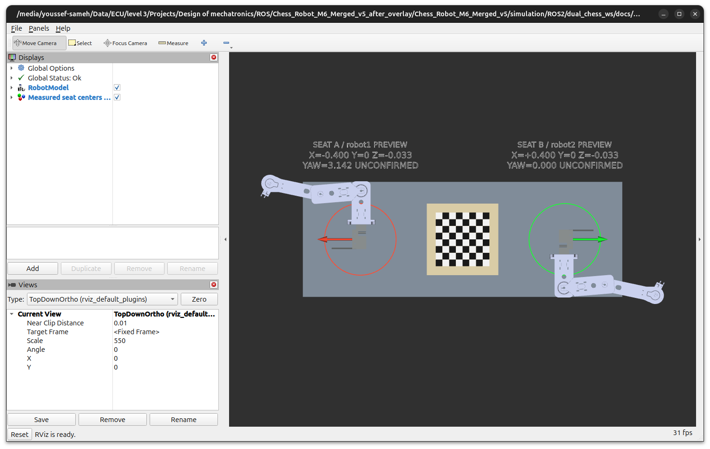

# Measured platform mounts and validation — 23/24 November 2026

## Outcome and remaining mechanical constraint

Both physical SCARA base faces are now centered on the exported platform's
circular pockets. Home is collision-free in MoveIt. RViz, TF and Gazebo use the
same measured geometry. **The supplied arm cannot reach this low board when
properly seated:** its numerically minimized TCP Z is 0.34701664 m versus a
0.010 m board surface. Every board square is unreachable for both arms.

Robot1 remains White; robot2 remains Black. The user has no confirmed yaw or
seat identity information. The retained yaw values and robot1=A / robot2=B
assignment are explicitly **unconfirmed previews**, not final assembly mates.
The user was shown the labelled A/B image and could not choose an identity yet.
No additional decision is assumed. Geometry and height checks remain valid
independently of this unresolved identity. No commit or push was made.

## Where the actual model comes from

- `src/chess_workcell_description/reference/original/`: preserved ROS 1 export
  from `/home/youssef-sameh/Downloads/AssemBase.SLDASM.zip`, including original
  URDF/CSV and meshes. It has enclosure/board frames, no arm mating frames.
- `meshes/controle_box.STL`: unchanged native platform geometry; metre units,
  no mesh scale. Its two 140 mm radius pockets determine center and plane.
- `meshes/controle_box_refined.STL`: derived, finer tessellation of those exact
  measured circles, used for both canonical visual and collision geometry.
- Active new-layout profile: `src/chess_workcell_description/config/workcell_sim.yaml`.
- Arm chain and physical base mesh: `dual_chess_description/urdf/arm/scara_v2.macro.xacro`
  and unchanged `meshes/scara_v2/base_link.STL` from the prior SCARA archive.
- `dual_chess.urdf.xacro` loads `geometry_file`; the board macro establishes the
  shared configuration. Manual URDF includes the platform; MoveIt excludes
  environment links and `chess_motion_interface.scene.Scene` owns the world mesh.
- Qt's file picker and `--geometry-file` pass this profile to the existing mode
  launches. Qt's default without the flag is still the older `chess_geometry.yaml`;
  use the exact command below for this new layout. No hidden mount override exists.
- Rebuilt installed profiles, meshes and Xacros were hash-compared to source.
  `source install/setup.bash` selects this checkout's overlay. Runtime TF and
  Gazebo scene poses are recorded, not inferred from a launch file alone.

## Derivation and transforms

Canonical platform coordinates use +Z up. The native platform has -Y up, so
world-from-export is Rx(-pi/2), translated by
`[-0.522123332705935, -0.689524212328646, -1.11365698223419]` m.
The unchanged board slab remains 280 × 280 × 10 mm, bottom Z=0/top Z=0.010.
The playing grid remains 26.25 mm pitch. Board/grid dimensions were not moved
to force reachability.

`mounting.py` and `tools/derive_workcell_mounts.py` fit the convex rim vertices
of the original circular pockets, excluding interior triangle fan points.
Maximum circle fit residual is below 0.05 micrometres. Measured world seats:

| Seat | Center XYZ (m) | Radius (m) | Plane normal |
|---|---|---|---|
| A | approximately `[-0.400, 0, -0.033]` | 0.140 | world +Z |
| B | approximately `[+0.400, 0, -0.033]` | 0.140 | world +Z |

The robot's physical bottom mounting face is **not at base_link's origin**.
In native `base_link`, its center is
`[0.003099998566726, 0.437521308660507, 0.098100001834524]` m,
normal +Y, radius 0.1397000014 m. The existing axis adapter maps this normal
onto world -Z. Bottom plate thickness is approximately 3 mm, matching the
platform's pocket depth. Preserve full STL precision when computing plane Z.

For each retained yaw, the configured origin is calculated as
`seat_center - (Rz(yaw) Rx(-pi/2)) * native_mount_face_center`.
No XYZ or yaw was estimated from the screenshot. Full precision is in
`mount_validation/derivation.json` and the YAML.

| Arm / preview seat | world → robotN_mount XYZ (m) | RPY (rad) |
|---|---|---|
| robot1 / White / A | `[-0.396899993488, +0.098100012562, +0.404521331736]` | `[0, 0, pi]` |
| robot2 / Black / B | `[+0.396899962093, -0.098099991108, +0.404521331736]` | `[0, 0, 0]` |

`world → robotN_base_link` has the same XYZ, with RPY `[-pi/2,0,pi]`
for robot1 and `[-pi/2,0,0]` for robot2. The mounting face centers transform
onto the measured A/B centers and normals oppose the platform plane to
numerical precision. The extra Rx is the URDF's existing CAD-axis adapter.
Yaw is preserved relative to the platform; the round pockets do not determine
clocking. The platform has no corresponding bolt/key pattern or exported arm
mate. The current home poses remain `[0.09,-pi/2,0]` (m,rad,rad).



The circles/arrows are RViz markers at the measured XY coordinates, and labels
are geometry strokes to avoid this RViz installation's missing text glyphs.
Labels are placed above the model for readability; they are not collision
geometry. A [perspective view](mount_validation/rviz_perspective.png) and live
[TF/contact evidence](mount_validation/contacts_final_mesh.json) accompany it.

## Verified collision geometry correction

The nominal pocket radius is 140 mm; the base foot is 139.7 mm. The original
pocket is only 22 segments: its chords cut about 1.4 mm inside that circle.
With the correctly seated foot, MoveIt reported about **1.049 mm** radial
base/platform penetration, matching a polygon-clearance calculation. This was
a tessellation error, not evidence that the centers needed moving.

`tools/refine_mount_pockets.py` preserves all other triangles and retessellates
only the measured circular pocket floors/walls/top boundary. Radius, plane and
platform extents remain unchanged; maximum arc chord error is about 5.33 µm.
The original export stays intact. Tests reproduce the old interference and
verify >0.28 mm radial clearance after refinement. Both visual and collision
meshes use the same refined asset. No collision pair was disabled.

An additional 3 nanometre contact was traced to rounding the measured seat Z.
Retaining the unrounded transformed plane and using full-precision Rx(-pi/2)
removed it, without inserting a shim or moving a base off its seat. Final live
whole-scene validity: **valid, zero contacts** at home, including platform,
board, pieces and the other arm. Original/refined/final contact JSON is saved.

## Reach, paths and actual execution are different results

`workcell_reachability.py` uses the actual active Xacro and joint limits. For
each arm, all 64 squares were tested at pawn/knight grasp, pawn/knight place, highest
approved approach and retreat endpoints: **384/384 failed endpoint IK per arm**. Numerical global FK height
optimization gives approximately `[0.34701664, 0.44702399]` m TCP Z. Even the
highest approved carried-piece approach is only 0.074 m. Changing yaw about
world Z or swapping A/B identities cannot remove this vertical deficit.

Capture-tray slots 0–15 were also tested at place/approach for each arm:
**all failed IK**. Pickup/place/retreat paths therefore cannot exist in this
configuration; no complete collision-free chess path or board transfer was
executed or advertised as successful. Home trajectories did execute through
mock ros2_control and returned controller/feedback success for both arms.

Unreachable squares, for **each of robot1 and robot2**, at the tested stages:

```text
a1 b1 c1 d1 e1 f1 g1 h1
a2 b2 c2 d2 e2 f2 g2 h2
a3 b3 c3 d3 e3 f3 g3 h3
a4 b4 c4 d4 e4 f4 g4 h4
a5 b5 c5 d5 e5 f5 g5 h5
a6 b6 c6 d6 e6 f6 g6 h6
a7 b7 c7 d7 e7 f7 g7 h7
a8 b8 c8 d8 e8 f8 g8 h8
```

See [per-arm/square/stage targets](mount_validation/reachability.json) and
[height/tray diagnostics](mount_validation/height_and_trays.json).

The exact c4/e5 position was initialized through the existing **mock-only**
scenario/startup flow and freshly synced by existing mock vision. This was
necessary because c4/e5 themselves cannot execute with the seated mechanics.
No successful robot acknowledgement or committed game move was fabricated.
The h2 pawn remained present. Both Qt board clicks and a direct ROS UCI g1f3
command produced `unreachable_g1_grasp` at `[0.065625,-0.091875,0.0243]`.
The first failure is now endpoint IK, before descent planning or any activity.
Thus the earlier pickup self/h2 collision cannot be declared solved by a
successful descent; that descent is mechanically unreachable at these mounts.

Qt remained responsive. The safe-rejection proof cleared the matching pending
plan, retained FEN/history, returned human controls after fresh ROS readiness,
and dispatched no Stockfish reply. For human Black, exactly one White opening
request was attempted on robot1; its rejection paused automatic progression
without retry or commit. Capture, castling, en passant and promotion scenarios
all rejected before activity, with the confirmed board unchanged. Promotion
operator confirmation cannot be exercised after a pickup that cannot happen;
its existing token flow remains covered by the existing logic/unit tests.

## Gazebo integration and limits

The original importer dropped the massless enclosure frame and generated an
invalid SDFormat frame graph. The Gazebo launch now generates a physics-only
robot URDF plus a **separate static enclosure SDF**, retaining the full RSP TF
model. No static enclosure mass/inertia is fabricated. Spawn pose components
are passed explicitly because `ros_gz_sim create` otherwise overrides SDF poses
with zero. Runtime Gazebo scene queries assert enclosure and both mount poses
against the same YAML. Absolute mesh paths preserve spaces correctly; escaped
file URIs were found not to load and were corrected.

The simulation floor is derived from the enclosure's lowest mesh point,
Z≈-0.23158465 m, rather than the old Z=0 floor that cut through the platform.
This is a simulation floor assumption, not a surveyed physical installation.
The static platform and board pose do not move when the floor is corrected.

The existing vertical-joint gain of 100 produced only 1 N for a 10 mm error,
insufficient for the imported moving mass against gravity. A profile-scoped
Gazebo-only PID now respects the unchanged ±100 N effort cap and unchanged
0–100 mm travel. Legacy profiles retain their gains. The final feedback test
checks both arms' rotary joint3 and vertical joint1: tolerances 0.02 rad and
0.003 m respectively, with actual samples recorded. These are simulation
tracking checks, not physical motor tuning or calibrated grasp accuracy.

Gazebo mode remains direct joint physics, not MoveIt chess execution. Its
normal mode has no complete dynamic chess-piece manipulation pipeline.

## Exact commands

From `Chess_Robot_M6_Merged_v5/simulation/ROS2/dual_chess_ws`:

```bash
source /opt/ros/jazzy/setup.bash
colcon build
source install/setup.bash
./scripts/run_desktop.sh --geometry-file "$PWD/src/chess_workcell_description/config/workcell_sim.yaml"
```

Use Manual to inspect placement, MoveIt for home/controller tests, or Full mock
chess → `After c4 e5: g1f3` to observe the measured reach rejection. Human vs
Stockfish currently cannot complete a match with the seated mechanics.

```bash
export PYTHONPATH="$PWD/.qt-deps:$PYTHONPATH" # only for local PySide6 installation
QT_QPA_PLATFORM=offscreen python3 -m pytest src -q
QT_QPA_PLATFORM=offscreen colcon test --return-code-on-test-failure --test-result-base .desktop-state/mount-test-results
colcon test-result --test-result-base .desktop-state/mount-test-results --verbose
python3 tools/static_audit.py
python3 tools/derive_workcell_mounts.py --geometry src/chess_workcell_description/config/workcell_sim.yaml --output docs/mount_validation/derivation.json
python3 tools/show_mount_alignment.py --domain 226
QT_QPA_PLATFORM=offscreen python3 tools/check_mount_runtime.py --mode exact --domain 228
QT_QPA_PLATFORM=offscreen python3 tools/check_mount_runtime.py --mode gazebo --domain 228
```

Run one app-managed mode per domain. Close the previous test before reusing
its domain. All audit helpers stop only their owned processes.

## Files changed and further decisions

- `chess_workcell_description/config/workcell_sim.yaml`, `mounting.py`, refined
  STL, `assembly.py`, normalized URDF/Xacro and README: measured, configurable
  seats with retained provisional yaw and shared refined geometry.
- `dual_chess_description/urdf/arm/scara_v2.macro.xacro`: full-precision axis
  adapter and optional profile-scoped Gazebo PID; unchanged joint limits.
- `dual_chess_gazebo/launch/gazebo.launch.py` and package manifest: valid static
  import, exact spawn poses, mesh paths/resources, derived simulation floor.
- Desktop `modes.py`, `test_modes.py`, new mounted-layout probe: reusable exact
  position scenario and focused validation through the existing interfaces.
- New motion-interface mounting/Gazebo regression tests; existing CAD tests.
- Four existing Python package setup/manifests declare their existing pytest
  tests correctly. Default colcon had selected unittest and run zero tests;
  that metadata issue is corrected instead of relying on stale result files.
- `tools/{derive_workcell_mounts,refine_mount_pockets,audit_mounted_height,
  inspect_mount_contacts,run_mount_scene_audit,show_mount_alignment,
  check_mount_runtime}.py`, this report and evidence.

Vision nodes, camera/calibration logic, schemas, fresh-confirmation rules,
SCARA meshes, motion limits and unrelated accumulated changes are preserved.

Before physical use, obtain assembly mates/clocking and seat identity, and
resolve the arm/platform vertical geometry with the mechanical team. For g1
alone, even the global minimum TCP is at least **322.7 mm above** the requested
pickup. This is a lower bound on the missing downward capability, not a
permission to extend software joint limits. Review the actual carriage height,
vertical travel and tool geometry; any physical redesign needs a new measured
URDF and collision/reach validation. A yaw adjustment alone cannot solve it.

## Final check summary

| Check | Actual result |
|---|---|
| Workspace build | 10 packages passed |
| Direct pytest | 223 passed |
| Default colcon test, fresh results | 197 tests, zero errors/failures/skips |
| Static audit / source–installed comparisons | Passed |
| Physical face/seat transforms and live TF | Passed; A/B identity and yaw still unconfirmed |
| Whole-scene home collision validity | Passed, zero contacts |
| Manual Qt sliders | Both arms passed; sole joint-state publisher |
| MoveIt home through mock controllers | Both arms executed successfully |
| Board approach/grasp/place/retreat endpoint IK | Failed mechanically on all 64 squares per arm |
| Capture-tray place/approach | Failed IK, slots 0–15 per arm |
| Exact c4/e5 g1f3, Qt and direct ROS | Same pre-activity unreachable rejection; h2/FEN preserved |
| Human White vs Stockfish | Human move safely rejected; no reply dispatched |
| Human Black vs Stockfish | Exactly one White opening request rejected; no automatic retry/commit |
| Capture/castling/en passant/promotion | Legally planned, safely rejected before activity; no board commit |
| Gazebo final | Enclosure loaded; actual enclosure/mount poses and rotations matched YAML; clock/joints valid |
| Gazebo direct joint feedback | Both arms' tested rotary/vertical targets within 0.02 rad / 0.003 m tolerances |
| Owned process cleanup and Qt responsiveness | Passed; maximum recorded GUI timer gap below 0.14 seconds |
| Successful chess execution / physical hardware | Not demonstrated: seated geometry cannot reach the board |

[Machine-readable final results](mount_validation/results.json) include actual
joint feedback, source/installed hashes, request/plan evidence links and the
original Gazebo failure distinguished from its verified correction. Earlier
off-platform match successes are historical and do not change these results.
